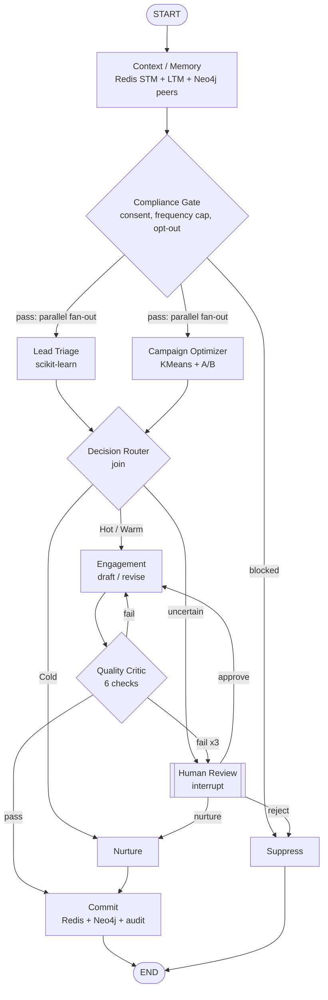

# Multi-Agent Lead Decisioning System

A LangGraph multi-agent system that makes automated **lead triage** and **campaign classification**
decisions. Each decision is explainable, bounded and auditable. When the system is unsure, it
escalates to a human instead of guessing.

**Stack:** Python · LangGraph · scikit-learn · Redis · Neo4j · Flask · WebSockets · Docker

```
python run.py            ->  http://127.0.0.1:5000
```

---

## What it does

Each lead goes through a graph of 11 specialised agents:



| Agent | Responsibility |
|---|---|
| **Context / Memory** | Builds the lead context from three kinds of memory: long-term preferences (seed LTM), short-term memory from Redis, and relational memory from Neo4j (how similar leads converted, prior decisions). Masks PII at this boundary. |
| **Compliance Gate** | Applies hard rules before any model runs: marketing consent, a Redis frequency cap (72h TTL), and channel-level opt-out taken from the latest interaction. Fails closed. |
| **Lead Triage** | scikit-learn conversion probability → Hot / Warm / Cold, with per-lead reason codes. Predictions inside an **uncertainty band** around the Hot threshold are not auto-decided. |
| **Campaign Optimizer** | Classifies campaign health with **scikit-learn KMeans** (k=4) on standardised ROAS, CPL, CTR and week-over-week trend. The unlabeled clusters are ranked by a weighted health score and named Scale / Maintain / Optimize / Pause. Picks a creative variant: a chi-square test must show p < 0.05 to declare a winner, otherwise it uses Thompson sampling. Leads on paused campaigns move to the best healthy campaign. Results are cached in Redis. |
| **Decision Router** | Joins the two parallel branches and routes to sales handoff / engage / nurture / human review. |
| **Engagement** | Drafts outreach from the selected creative, personalised by industry, interest and contact window. On revision it applies targeted fixes for each critic issue code. |
| **Quality Critic** | Independently checks every draft (permitted channel, length limits, personalisation, CTA fit for tier, opt-out text, unresolved placeholders). A failed draft is sent back for revision. After 3 failed revisions the lead escalates to a human. |
| **Human Review** | LangGraph `interrupt()`: the graph pauses with its state checkpointed, then resumes with `Command(resume=...)` when a reviewer approves, nurtures or rejects. |
| **Nurture / Commit / Suppress** | Terminal actions. They persist the decision to Redis (memory, frequency cap), Neo4j (`Decision` node linked to lead and campaign) and a JSONL audit log. |

### LangGraph features used
- **Typed shared state** (`TypedDict`). Each agent writes only its own keys, and an additive reducer on `trace` lets parallel agents both append.
- **Parallel fan-out and join.** Triage and the optimizer run concurrently in one super-step, and the router waits for both.
- **Conditional edges** for routing, plus a **bounded cycle** (engagement ⇄ critic).
- **Human-in-the-loop** with `interrupt()` + `InMemorySaver` checkpointing, resumed via `Command`.
- The Mermaid graph on the Architecture tab is generated from the compiled graph (`get_graph().draw_mermaid()`).

---

## Why Redis *and* Neo4j

| | Redis | Neo4j |
|---|---|---|
| Holds | Fast, ephemeral state agents need during a run | Relationship-heavy data that persists |
| Examples | short-term memory (24h TTL), frequency cap (72h TTL), campaign-analysis cache, run event lists + pub/sub, per-agent latency counters | `(:Lead)-[:FROM_CAMPAIGN]->(:Campaign)`, `IN_INDUSTRY`, `HAS_PERSONA`, `CONVERTED`, `(:Lead)-[:HAS_DECISION]->(:Decision)-[:FOR_CAMPAIGN]->(:Campaign)` |
| Question answered | "Was this lead contacted in the last 72h?" | "How did leads with this industry and persona convert, and through which channel?" |

After each run, the dashboard draws the lead's Neo4j neighbourhood and shows the Cypher that
produced it. The same query can be pasted into Neo4j Browser (`http://localhost:7474`).

**Graceful degradation.** If a Redis server isn't reachable, the same code runs against
`fakeredis`, an in-process implementation of the Redis protocol. If Neo4j isn't reachable,
an equivalent NetworkX graph answers the same queries. The header chips on the dashboard show
which backend is live. The fallbacks exist for portability. The system is developed, tested and
demonstrated against real Redis and Neo4j.

---

## Evaluation: data integrity first

Before training, I checked whether the seed labels carry any signal. **They don't.**
Cross-validated ROC-AUC against the dataset's own `conversions.csv` is **0.50** for every model,
and `triage_category` accuracy is below the majority-class baseline. A model trained on those
labels would look like it works and would have learned nothing.

So outcomes are **simulated from a documented process** ([app/ml/labels.py](app/ml/labels.py)):
engagement quality, fit and recency drive intent, and noise is added. The feature engineering,
model selection, evaluation and decision policy are the same ones that would run on real CRM
outcomes. Only the label source differs, and the dashboard says so.

| Metric (held-out 20%) | Value |
|---|---|
| ROC-AUC | **0.863** |
| Baseline: `lead_score` alone | 0.632 |
| PR-AUC (base rate 32%) | 0.758 |
| Brier score | 0.135 |
| Hot tier observed conversion | 76% (Warm 40%, Cold 8%) |
| Seed-label sanity check | 0.50 |

**Campaign classification** (scikit-learn KMeans, k=4, 30 campaigns): Scale 5, Maintain 10,
Optimize 11, Pause 4. The Pause cluster is the high-CPL, low-CTR group, and the Scale cluster
is high-ROAS with a rising trend. Centroids and a ROAS vs CPL scatter are on the
*Models & evaluation* tab.

Logistic regression (CV AUC 0.850) was kept over gradient boosting (0.836). Boosting would need
to win by more than 0.02 AUC to be chosen, because coefficients give per-lead **reason codes**
and every automated decision should be explainable.

**Full-population run** against live Redis + Neo4j: all 5,000 leads on 8 worker threads in about
4 minutes. Results: 12% sales handoff, 17% engage, 34% nurture, 34% suppressed (mostly no consent),
3% held for human review, 0 failures, and about 4,850 `Decision` nodes written to the graph.

---

## Observability

Every node is wrapped by a tracer ([app/observability.py](app/observability.py)) that emits
`node_started` / `node_finished` / `node_paused` / `node_failed`, each with latency, a
one-line human-readable summary and the state update. Events go to:
- Redis (`run:{id}:events` list + `agent-events` pub/sub), so any run can be replayed
- `outputs/traces.jsonl` (durable audit trail) and `outputs/decisions.jsonl`
- a WebSocket, so the dashboard animates the graph live

Per-agent call counts and average latency are aggregated in Redis (`/api/metrics`).

---

## Run it

```powershell
python -m venv venv
venv\Scripts\activate
pip install -r requirements.txt
python -m app.ml.train          # trains model + writes models/model_card.json
```

**Real Redis + Neo4j on Windows, no Docker:** `start_demo.bat` starts a Redis server, Neo4j
Community 5.26 and the dashboard, then opens http://127.0.0.1:5000. It expects the portable
installs in `E:\AIML\tools` (override with the `TOOLS` env var).

**Docker:**
```bash
docker compose up --build       # app :5000, Neo4j browser :7474, Redis :6379
```

**App only** (in-process Redis/graph fallbacks): `python run.py`

Terminal only:
```powershell
python scripts/run_lead.py L0000003 L0000391
python scripts/run_lead.py L0000173 --review approve
python scripts/run_lead.py --mermaid
python -m pytest tests -q       # 11 end-to-end tests covering every path (pass on live Redis + Neo4j)
```

### Dashboard
- **Live run.** Pick a scenario and watch the graph execute. Nodes light up as agents run, loop
  counters show revisions, and the decision panel fills in (reason codes, campaign health, critic
  feedback per draft). Human review shows Approve / Nurture / Reject buttons that resume the paused graph.
- **Models & evaluation.** Lead-triage metrics, calibration curve, permutation importance, tier outcomes and model selection. Also the KMeans campaign clusters, centroids and scatter plot.
- After each run, the decision panel also shows the **lead's Neo4j graph** (with its Cypher) and the **Redis keys** the run wrote, with their TTLs.
- **Batch & metrics.** Run N leads concurrently, with the route distribution, per-agent latency and the review queue.
- **Architecture.** Component map, reliability principles, and the Mermaid graph generated from the compiled workflow.

### API
| Method | Path | |
|---|---|---|
| POST | `/api/runs` `{lead_id}` | start a run (async) |
| GET | `/api/runs/<id>` | metadata, full event trace, graph state |
| POST | `/api/runs/<id>/review` `{action, note}` | resume a paused run |
| POST | `/api/batch` `{n}` | run N random leads concurrently |
| GET | `/api/leads/<id>/graph` | the lead's Neo4j neighbourhood + the Cypher used |
| GET | `/api/campaigns` | KMeans campaign clusters and centroids |
| GET | `/api/leads/<id>` | Redis memory, frequency cap, Neo4j decision history |
| GET | `/api/graph` · `/api/model` · `/api/metrics` · `/api/health` | introspection |
| WS | `/ws` | live trace events |

---

## Project layout

```
app/
  agents/        one module per agent + shared LeadState
  ml/            features, simulated labels, training, inference + reason codes
  state/         redis_store.py (Redis/fakeredis), graph_store.py (Neo4j/NetworkX)
  graph.py       LangGraph wiring: nodes, conditional edges, loop, interrupt
  orchestrator.py  start / resume / batch, checkpointing
  observability.py tracer + event bus
  web/           Flask API, WebSocket, dashboard
seeds/           synthetic marketing dataset (leads, campaigns, interactions, ...)
tests/           end-to-end tests for every graph path
```

## Design decisions and trade-offs
- **Deterministic engagement copy, no LLM.** Decisioning has to be reproducible and auditable. The
  engagement agent is template-based, so an LLM drafter could replace it without changing the critic,
  which is the part that enforces constraints.
- **Hard rules before ML.** A blocked lead never reaches the model. This removes a whole class of
  "the model said yes" compliance failures.
- **Critic separate from generator.** The agent that writes a draft never grades it.
- **Bounded loops.** Revisions are capped at 3, then the lead escalates to a human.
- **Checkpointer.** `InMemorySaver` for the demo. In production I'd swap in a persistent
  checkpointer (Redis or Postgres) so paused reviews survive restarts.
